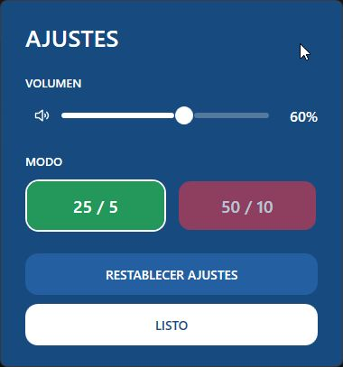

# AutoPomodoro para Windows 11

[](https://github.com/jstihl01/AutoPomodoro/releases/download/v2.0.1/AutoPomodoro-Setup-v2.0.1.exe)

Temporizador Pomodoro de escritorio sincronizado con la hora local de Windows. Abre la aplicación y el contador se ajusta a la fase que corresponda.

[Guía ilustrada](#guía-de-uso) · [Instalar y verificar](#instalar-y-verificar) · [Compilar](#compilar)

## Guía de uso

Las capturas muestran [AutoPomodoro 2.0.2 preliminar](https://github.com/jstihl01/AutoPomodoro/releases/tag/v2.0.2-preview) con horas de ejemplo. El texto de fase del widget y el atajo `F2` están disponibles desde esa versión.

### Lee el contador

Abre **AutoPomodoro** desde el menú Inicio o desde su acceso directo. La fase depende de la hora local. El número indica cuánto queda hasta el siguiente cambio.

| Trabajo 25/5 | Trabajo 50/10 | Descanso |
| --- | --- | --- |
|  |  |  |

- **25/5.** El trabajo comienza a los minutos `:00` y `:30`. El descanso comienza a los minutos `:25` y `:55`.
- **50/10.** El trabajo comienza a la hora en punto. El descanso comienza al minuto `:50`.
- Un tono anuncia el descanso y tres tonos anuncian la vuelta al trabajo. Al abrir AutoPomodoro, cambiar de modo o reajustar el reloj, se actualiza en silencio.

Puedes arrastrar el fondo para mover la ventana y sus bordes para cambiar el tamaño. Permanece encima de las ventanas normales.

### Elige el modo y el volumen

Pulsa el **engranaje** de la esquina superior derecha para abrir Ajustes.



1. Elige **25/5** o **50/10**.
2. Regula el volumen entre **0 % y 100 %**. Pulsa el altavoz para escuchar una prueba al nivel elegido.
3. Pulsa **LISTO** o `Esc` para aplicar y guardar los cambios. **Restablecer ajustes** recupera también el tamaño y la posición de la ventana al cerrar el panel.

### Usa el widget en la barra de tareas

Pulsa **minimizar** (el botón a la izquierda del engranaje). El contador pasa a una cápsula junto al área de notificación de la barra principal.

| Contador del widget | Panel de volumen |
| --- | --- |
|  |  |

- Pulsa **el contador** para volver a la ventana principal y abrir Ajustes desde el engranaje. Volver a abrir el acceso directo también recupera la ventana.
- Pasa el puntero por **el altavoz** para mostrar el volumen. Pulsa el icono para silenciar o volver al último nivel audible.
- Con el foco en el widget, pulsa `F2` para ir al deslizador y usa las flechas para ajustar el volumen. `Esc` devuelve el foco al altavoz.
- El widget se oculta con la barra de tareas o ante una ventana a pantalla completa. Si la barra horizontal principal deja de estar disponible, se recupera la ventana y se conserva la vista preferida para el próximo arranque.

### Cierra AutoPomodoro

Pulsa `Alt+F4` con el foco en la ventana o en el widget. También puedes cerrar la ventana desde su icono en la barra de tareas. Mientras AutoPomodoro está abierto, solicita a Windows que mantenga activos el equipo y la pantalla.

Los ajustes se guardan en `%LocalAppData%\AutoPomodoro\settings.json`. Si aparece un aviso de guardado pendiente, vuelve a Ajustes y pulsa **LISTO** para reintentar.

## Instalar y verificar

El botón descarga la versión estable 2.0.1 para Windows 11 x64. El instalador funciona por usuario y crea accesos en el escritorio y en el menú Inicio. Volver a ejecutarlo actualiza la aplicación y conserva los ajustes.

Windows SmartScreen puede advertir que el instalador 2.0.1 carece de firma Authenticode. Para comprobar la integridad de la descarga, compara el resultado con el [SHA-256 de v2.0.1](https://github.com/jstihl01/AutoPomodoro/releases/download/v2.0.1/AutoPomodoro-Setup-v2.0.1.exe.sha256). El SHA-256 verifica el archivo, mientras que la firma Authenticode identifica al editor.

```powershell
Get-FileHash .\AutoPomodoro-Setup-v2.0.1.exe -Algorithm SHA256
```

Desde 2.0.2, la desinstalación retira solo los archivos de ajustes propios de `%LocalAppData%\AutoPomodoro` y elimina la carpeta si queda vacía. La carpeta heredada `%LocalAppData%\Pomodoro` se conserva íntegra. La versión 2.0.1 elimina ambas carpetas completas al desinstalar.

## Compilar

- Windows 11 x64
- SDK de .NET 10 indicado en `global.json`
- Inno Setup 6.3.0 o posterior
- Git

```powershell
.\build.ps1 -TestInstaller
```

El script comprueba el compilador de Inno Setup antes de compilar, ejecuta las pruebas de reloj e integración WPF y comprueba el arranque y el runtime del ejecutable autocontenido. `-TestInstaller` añade la instalación, reinstalación y desinstalación en rutas temporales con un identificador distinto. Los artefactos quedan en `releases\` con el número de versión en el nombre. Conserva juntos el instalador, su SHA-256 y el archivo `.build.json`, que registra el commit, el estado de las fuentes, el SDK, Inno Setup y los runtimes incluidos.

Para una entrega firmada, prepara un commit limpio, un certificado de firma de código con clave privada en `CurrentUser\My` y el `signtool.exe` del SDK de Windows.

```powershell
.\build.ps1 -TestInstaller -Release -SignTool 'C:\ruta\signtool.exe' -CertificateThumbprint '<huella>'
```

Ese modo verifica la firma y el sello de tiempo del instalador y del desinstalador antes de generar el checksum. Vuelve a compilar y distribuir la aplicación al incorporar parches del runtime autocontenido. Actualiza el instalador y el checksum del README a la misma etiqueta de GitHub y publica el manifiesto de la misma compilación.

## Privacidad y limitaciones

La aplicación funciona sin red, cuentas ni telemetría. Windows conserva el control sobre los bloqueos manuales, las políticas de energía, los protectores de pantalla y la suspensión forzada. La superposición se aplica al escritorio normal.
